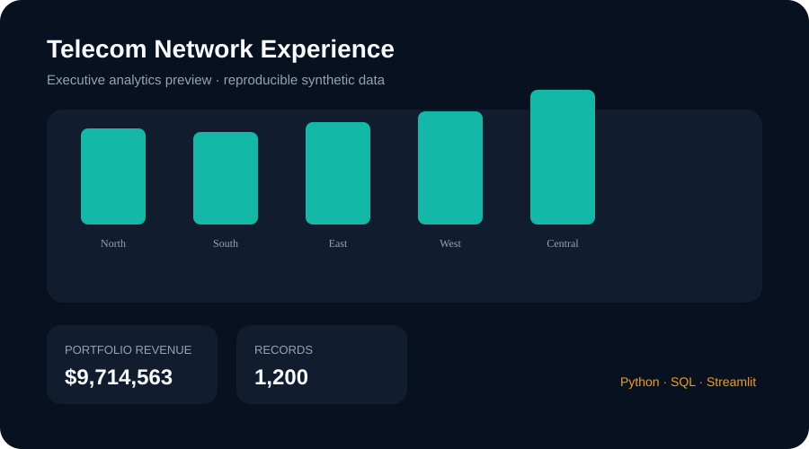

    # Telecom Network Experience

    

    An end-to-end analytics case study that converts **1,200 synthetic but business-realistic network observations** into decision-ready insights. The project is reproducible, privacy-safe, and designed to demonstrate analyst work from raw data through executive communication.

    ## Business question

    Where is performance being created or lost, which segments require intervention, and what should leadership prioritize next?

    ## Decision metrics

    | KPI | Decision use |
    |---|---|
    | Availability | Track performance and trigger investigation |
| Dropped Call Rate | Track performance and trigger investigation |
| Download Speed | Track performance and trigger investigation |
| Complaint Rate | Track performance and trigger investigation |

    ## Stack

    Python (pandas, Plotly, Streamlit), SQL (SQLite-compatible), CSV, automated tests, GitHub Actions.

    ## Repository map

    - `data/raw/observations.csv` — versioned source data
    - `src/analysis.py` — validation, transformation and KPI pipeline
    - `sql/analysis.sql` — reusable business queries
    - `dashboard/app.py` — interactive executive dashboard
    - `reports/INSIGHTS.md` — concise findings and recommendations
    - `tests/test_analysis.py` — data and metric checks
    - `docs/INSTALLATION.md` — complete environment setup
    - `docs/DATA_DICTIONARY.md` — field definitions and validation rules
    - `docs/GUARDRAILS.md` — privacy, quality and decision-safety controls

    ## Run locally

    ```bash
    python -m pip install -r requirements.txt
    python src/analysis.py
    streamlit run dashboard/app.py
    pytest
    ```

    ## Analytical contract

    Revenue and cost are non-negative; `quality_score` is bounded 0–100; `risk_flag` is binary; dates must parse; segment-level KPIs reconcile to portfolio totals.

    ## Headline finding

    The lowest-quality region cohort carries a disproportionate share of risk flags. The recommended action is a targeted operating review rather than a portfolio-wide intervention.

    ## Data note

    The dataset is generated with a fixed seed and deliberately contains realistic variation. It represents no real person or company and is safe to publish.
